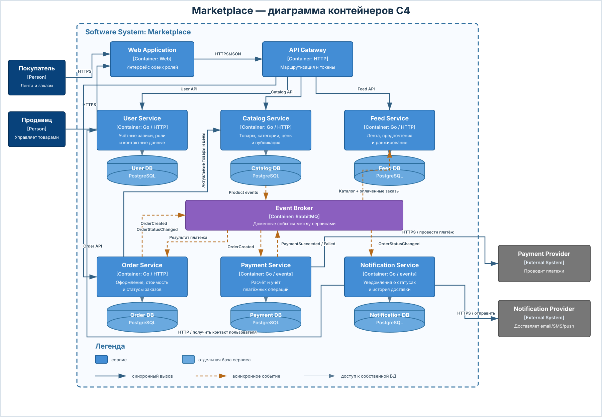

# Маркетплейс

Цель проекта — написать свой учебный маркетплейс и постепенно добавлять в него новые части в следующих домашних заданиях.

Сейчас в проекте есть описание архитектуры маркетплейса, C4-диаграмма, OpenAPI-контракт и реализация двух микросервисов. Commerce Service работает с товарами, промокодами и заказами, а User Service регистрирует пользователей и выдаёт access- и refresh-токены.

C4-диаграмма показывает целевую архитектуру всего маркетплейса. На текущем этапе реализованы User Service и Commerce Service. API Gateway пока не добавлен, поэтому локально клиент обращается к сервисам напрямую: к Commerce Service на порту `8080`, к User Service — на порту `8081`.

## C4-диаграмма



Исходник диаграммы: [`docs/architecture/c4-container.puml`](docs/architecture/c4-container.puml).

## OpenAPI

Внешний контракт находится в [`api/openapi.yaml`](api/openapi.yaml). Он описывает:

- регистрацию, вход и обновление токенов;
- CRUD товаров, фильтрацию и пагинацию;
- создание, получение, изменение, отмену заказа и переходы его состояния;
- создание глобальных промокодов;
- JWT-авторизацию и роли `USER`, `SELLER`, `ADMIN`;
- валидацию запросов и единый формат ошибок.

| Метод | Endpoint | Назначение |
|---|---|---|
| `POST` | `/auth/register` | Регистрация |
| `POST` | `/auth/login` | Получение access- и refresh-токенов |
| `POST` | `/auth/refresh` | Обновление токенов |
| `POST` | `/products` | Создание товара |
| `GET` | `/products` | Список товаров с фильтрами и пагинацией |
| `GET` | `/products/{id}` | Получение товара |
| `PUT` | `/products/{id}` | Полное обновление товара |
| `DELETE` | `/products/{id}` | Мягкое удаление товара |
| `POST` | `/orders` | Создание заказа |
| `GET` | `/orders/{id}` | Получение заказа |
| `PUT` | `/orders/{id}` | Замена состава заказа |
| `POST` | `/orders/{id}/cancel` | Отмена заказа |
| `PATCH` | `/orders/{id}/status` | Переход заказа в следующее состояние |
| `POST` | `/promo-codes` | Создание глобального промокода |

## Кодогенерация

DTO, интерфейсы обработчиков и маршруты обоих сервисов генерируются из [`api/openapi.yaml`](api/openapi.yaml) с помощью `oapi-codegen`. Версия генератора зафиксирована в `go.mod` каждого сервиса как tool dependency.

Запустить генерацию из корня проекта:

```bash
make generate
```

Для Commerce Service выбираются операции с тегами `System`, `Products`, `Orders` и `Promo codes`, для User Service — `System` и `Auth`. Настройки лежат в `internal/api/oapi-codegen.yaml` соответствующего сервиса.

Результат записывается в `internal/api/generated/*.gen.go`. Сгенерированные файлы добавлены в `.gitignore`: они воспроизводятся командой `make generate` и автоматически создаются при сборке Docker-образов. Ручные DTO для HTTP API не используются.

## Команды разработки

Основные команды собраны в `Makefile`:

```bash
make help          # показать доступные команды
make generate      # сгенерировать HTTP API обоих сервисов
make build         # собрать оба сервиса
make vet           # запустить go vet
make fmt-check     # проверить форматирование
make verify        # выполнить все статические проверки
make up            # собрать и поднять проект в Docker
make down          # остановить контейнеры
make ps            # показать состояние контейнеров
make logs          # показать логи сервисов
make db-commerce   # открыть psql для Commerce DB
make db-user       # открыть psql для User DB
make reset         # удалить контейнеры и локальные данные БД
```

`make reset` удаляет Docker volumes обеих баз. Для обычной остановки используется `make down`.

## База данных и миграции

Commerce Service использует отдельную PostgreSQL-базу. Схема создаётся Flyway-миграцией [`V1__create_commerce_schema.sql`](services/commerce-service/migrations/V1__create_commerce_schema.sql) и содержит таблицы:

- `products` — товары, цены, статусы и остатки;
- `promo_codes` — глобальные промокоды и счётчик использований;
- `orders` — заказы и их состояния;
- `order_items` — позиции заказа и цена товара на момент оформления;
- `user_operations` — операции создания и изменения заказов для проверки ограничения частоты.

В базе есть обязательный индекс по `products.status`, ограничения для цен и остатков, связи между таблицами Commerce Service и автоматическое обновление `updated_at`. Индекс `orders_one_active_per_user_idx` не позволяет создать пользователю больше одного заказа в статусе `CREATED` или `PAYMENT_PENDING`.

Поля `seller_id` и `user_id` содержат идентификаторы из User Service, но не являются внешними ключами: Commerce Service не обращается к базе другого сервиса.

User Service использует отдельную User DB. Flyway-миграция создаёт таблицу пользователей и таблицу refresh-сессий. Пароль хранится только в виде bcrypt-хеша, а полный refresh JWT в базу не записывается — сохраняется его SHA-256-хеш.

## Домены и сервисы

| Домен | Сервис | За что отвечает |
|---|---|---|
| Пользователи | User Service | Регистрация, вход, JWT, роли и контакты |
| Торговые операции | Commerce Service | Товары, цены, остатки, заказы, позиции и промокоды |
| Лента и персонализация | Feed Service | Просмотры, предпочтения, популярность товаров и порядок выдачи |
| Платежи | Payment Service | Обращение к платёжному провайдеру и учёт результата |
| Уведомления | Notification Service | Отправка уведомлений при изменении статуса заказа |

Покупатель, продавец и администратор — роли одной учётной записи в User Service. Продавец управляет своими товарами через Commerce Service, покупатель работает с лентой и заказами, а администратор может выполнять операции с любыми товарами и заказами.

Доставка, отзывы и административный интерфейс в текущий scope не входят. Статус `SHIPPED` нужен для модели состояний заказа, но отдельный Delivery Service пока не проектируется.

## Почему товары и заказы находятся в одном сервисе

Создание заказа должно атомарно уменьшать остатки, сохранять позиции и цены, применять промокод и записывать операцию пользователя. Обновление и отмена заказа также одновременно меняют заказ, остатки и счётчик использования промокода.

Если Catalog Service и Order Service владеют разными базами, для этого понадобятся saga и компенсирующие операции. В текущем задании требуется одна транзакция, поэтому эти данные объединены в Commerce Service и Commerce DB.

Это не объединяет весь маркетплейс в один процесс: User, Feed, Payment и Notification остаются независимыми сервисами со своими базами. Решение подробно описано в [`ADR-002`](docs/adr/002-commerce-service-boundary.md).

## Как работает персонализация

- новый или неавторизованный пользователь видит популярные опубликованные товары;
- для авторизованного пользователя выше показываются категории, которые он чаще смотрит и покупает;
- Feed Service получает изменения товаров и информацию об оплаченных заказах через события;
- у Feed Service есть своя проекция данных, необходимая для построения ленты;
- актуальные карточки, цены и остатки по-прежнему принадлежат Commerce Service.

Feed Service не участвует в транзакции оформления заказа. Его временная недоступность не должна блокировать создание товара или заказа.

## Кто какими данными владеет

У каждого сервиса своя база PostgreSQL. Сервисы не используют общие таблицы и не обращаются напрямую к чужим базам.

| Сервис | Какие данные хранит |
|---|---|
| User Service | Пользователи, данные для входа, роли, контакты и refresh-токены |
| Commerce Service | Товары, цены, остатки, заказы, позиции, снимки цен, промокоды и операции пользователей |
| Feed Service | Просмотры, предпочтения, популярность и проекцию опубликованных товаров |
| Payment Service | Платежи, попытки оплаты, идентификаторы внешних транзакций и их статусы |
| Notification Service | Шаблоны, попытки отправки и результаты доставки уведомлений |

Идентификаторы `user_id` и `seller_id` хранятся в Commerce DB как ссылки на пользователей, но не являются внешними ключами в User DB.

## Как сервисы взаимодействуют

В целевой архитектуре HTTP используется, когда ответ нужен сразу, а RabbitMQ — для событий, которые можно обработать асинхронно. В текущем локальном окружении реализованы только прямые HTTP-вызовы User Service и Commerce Service.

| Откуда | Куда | Как | Для чего |
|---|---|---|---|
| Web Application | API Gateway | HTTPS, синхронно | Все запросы пользователей |
| API Gateway | User Service | HTTP, синхронно | Регистрация, вход и обновление токена |
| API Gateway | Commerce Service | HTTP, синхронно | Товары, заказы и промокоды |
| API Gateway | Feed Service | HTTP, синхронно | Получение ленты и запись просмотров |
| Commerce Service | Feed Service | RabbitMQ, асинхронно | Изменения товаров и оплаченные заказы |
| Commerce Service | Payment Service | RabbitMQ, асинхронно | Создание платежа после оформления заказа |
| Payment Service | Commerce Service | RabbitMQ, асинхронно | Передача результата оплаты |
| Commerce Service | Notification Service | RabbitMQ, асинхронно | Уведомление после изменения статуса заказа |
| Notification Service | User Service | HTTP, синхронно | Получение актуального контакта пользователя |
| Payment Service | Payment Provider | HTTPS, синхронно | Проведение платежа |
| Notification Service | Notification Provider | HTTPS, синхронно | Отправка сообщения пользователю |

Сообщение из RabbitMQ может прийти повторно, поэтому обработчики событий должны быть идемпотентными.

## Как создаётся заказ

Commerce Service выполняет в одной транзакции:

1. Проверяет ограничение частоты создания заказа.
2. Проверяет, что у пользователя нет активного заказа.
3. Блокирует необходимые товары и проверяет их статус и остатки.
4. Фиксирует цену каждой позиции на момент заказа.
5. Проверяет глобальный промокод и рассчитывает скидку.
6. Ограничивает процентную скидку 70% от суммы заказа.
7. Уменьшает остатки и создаёт заказ с позициями.
8. Увеличивает счётчик использования промокода.
9. Записывает операцию пользователя.

При ошибке вся транзакция откатывается. После успешного создания заказ получает статус `CREATED`. В целевой архитектуре Commerce Service публикует `OrderCreated`, Payment Service проводит оплату и возвращает результат отдельным событием.

## Рассмотренные варианты

### Отдельные Catalog, Inventory, Order и Promotion Service

Плюсы:

- узкие границы ответственности;
- независимое масштабирование;
- отказ одного домена меньше влияет на остальные.

Минусы:

- создание и изменение заказа требуют saga;
- нужны компенсации, идемпотентность и eventual consistency;
- вариант не соответствует требованию одной транзакции.

### Сервисы с общей базой

Плюсы:

- можно выполнить одну транзакцию;
- приложения остаются отдельными процессами.

Минусы:

- несколько сервисов владеют одними таблицами;
- схемы и релизы сервисов становятся связанными;
- нарушается принцип database per service.

### Commerce Service

Плюсы:

- транзакционные операции выполняются атомарно;
- у базы остаётся один владелец;
- не нужны распределённые транзакции и saga.

Минусы:

- каталог и заказы разворачиваются и масштабируются вместе;
- Commerce Service имеет больший радиус отказа;
- разделение в будущем потребует изменения модели согласованности.

Для текущих требований выбран Commerce Service. Feed Service остаётся отдельной read-моделью и не входит в эту транзакционную границу.

## Что реализовано

Сгенерированные маршруты, DTO и strict-server интерфейсы подключены к обоим сервисам. Запрос проходит через слои в таком порядке:

```text
HTTP request → handler → service → repository → PostgreSQL
```

- `internal/handler` работает с HTTP, generated DTO и данными из JWT;
- `internal/service` проверяет роли и владельцев, выполняет расчёты и управляет транзакциями;
- `internal/repository` содержит запросы к PostgreSQL и не принимает бизнес-решений.

Реализованы CRUD товаров, мягкое удаление, пагинация и фильтры, создание промокодов, а также создание, чтение, изменение, отмена и переходы состояний заказа. Создание, изменение и отмена заказа выполняются в транзакциях с блокировкой строк товаров и промокодов. Денежные значения внутри сервиса хранятся в целых сотых, поэтому расчёты не зависят от ошибок `float`.

Все операции, кроме health-check, защищены JWT. Commerce Service проверяет HMAC-подпись, issuer, срок действия, `sub`, роль и claim `token_type=access`. Секрет и issuer должны совпадать с настройками User Service, который выдаёт токены.

User Service реализует регистрацию `USER` и `SELLER`, вход и обновление токенов. Access JWT действует 20 минут, refresh JWT — 14 дней. При обновлении refresh-токен ротируется: старая запись удаляется и заменяется новой одной SQL-операцией. Локальный администратор может быть создан при запуске через `ADMIN_EMAIL` и `ADMIN_PASSWORD`.

Проверка работоспособности:

```http
GET /health HTTP/1.1
Host: localhost:8080
```

Ответ:

```http
HTTP/1.1 200 OK
Content-Type: application/json

{"service":"commerce-service","status":"ok"}
```

Основные настройки Commerce Service:

| Переменная | Значение по умолчанию | Назначение |
|---|---|---|
| `DATABASE_URL` | локальная Commerce DB | Строка подключения к PostgreSQL |
| `JWT_SECRET` | локальный секрет для разработки | Проверка подписи access-токена |
| `JWT_ISSUER` | `marketplace-user-service` | Ожидаемый издатель токена |
| `ORDER_RATE_LIMIT` | `1m` | Минимальный интервал между однотипными операциями с заказом |
| `PORT` | `8080` | HTTP-порт сервиса |

Основные настройки User Service:

| Переменная | Значение по умолчанию | Назначение |
|---|---|---|
| `DATABASE_URL` | локальная User DB | Строка подключения к PostgreSQL |
| `JWT_SECRET` | локальный секрет для разработки | Подпись access- и refresh-токенов |
| `JWT_ISSUER` | `marketplace-user-service` | Издатель JWT |
| `ACCESS_TOKEN_TTL` | `20m` | Срок действия access-токена |
| `REFRESH_TOKEN_TTL` | `336h` | Срок действия refresh-токена |
| `ADMIN_EMAIL` | не задан | Email локального администратора |
| `ADMIN_PASSWORD` | не задан | Начальный пароль локального администратора |
| `PORT` | `8081` | HTTP-порт сервиса |

## Как запустить

### В Docker

Нужны Docker Engine или совместимая среда, например Colima, и Docker Compose v2.

```bash
make up
```

Эта команда выполняет `docker compose up --build -d`.

Чтобы при старте создать локального администратора, скопируйте `.env.example` в `.env` и замените пример пароля. Без этих переменных User Service запустится, но администратора автоматически не создаст.

При запуске обе PostgreSQL-базы сначала проходят health-check, затем Flyway применяет миграции, и только после этого запускаются сервисы. Во время сборки код API генерируется из OpenAPI-контракта автоматически.

Проверить контейнер и health-check:

```bash
docker compose ps -a
curl -i http://localhost:8080/health
curl -i http://localhost:8081/health
```

Проверить применённые миграции и созданные таблицы:

```bash
docker compose exec commerce-db psql -U marketplace -d marketplace_commerce \
  -c "SELECT version, description, success FROM flyway_schema_history ORDER BY installed_rank;"

docker compose exec commerce-db psql -U marketplace -d marketplace_commerce -c "\\dt"

docker compose exec user-db psql -U marketplace -d marketplace_user \
  -c "SELECT version, description, success FROM flyway_schema_history ORDER BY installed_rank;"

docker compose exec user-db psql -U marketplace -d marketplace_user -c "\\dt"
```

Commerce DB доступна на `localhost:5432`, User DB — на `localhost:5433`. Значения можно заменить переменными окружения из `compose.yaml`.

Остановить контейнер:

```bash
make down
```

Чтобы удалить также локальные данные PostgreSQL и при следующем запуске создать базу заново:

```bash
make reset
```

Краткий порядок ручной демонстрации и примеры запросов находятся в [`docs/e2e.md`](docs/e2e.md).

### Без Docker

Понадобятся Go 1.26 или новее, `make`, две локальные PostgreSQL-базы и применённые Flyway-миграции. Сервисы запускаются в разных терминалах:

```bash
make run-user
make run-commerce
```

После запуска в другом терминале:

```bash
curl -i http://localhost:8080/health
curl -i http://localhost:8081/health
```

## Структура проекта

```text
.
├── api
│   └── openapi.yaml
├── Makefile
├── README.md
├── compose.yaml
├── docs
│   ├── architecture
│   │   ├── c4-container.puml
│   │   └── c4-container.svg
│   ├── adr
│   │   ├── 001-service-decomposition.md
│   │   ├── 002-commerce-service-boundary.md
│   │   └── 003-user-service.md
│   └── e2e.md
└── services
    ├── commerce-service
    │   ├── Dockerfile
    │   ├── go.mod
    │   ├── go.sum
    │   ├── cmd/server/main.go
    │   ├── migrations
    │   └── internal
    │       ├── api
    │       ├── auth
    │       ├── config
    │       ├── domain
    │       ├── handler
    │       ├── repository
    │       └── service
    └── user-service
        ├── Dockerfile
        ├── go.mod
        ├── go.sum
        ├── cmd/server/main.go
        ├── migrations
        │   └── V1__create_user_schema.sql
        └── internal
            ├── api
            ├── config
            ├── domain
            ├── handler
            ├── repository
            └── service
```
